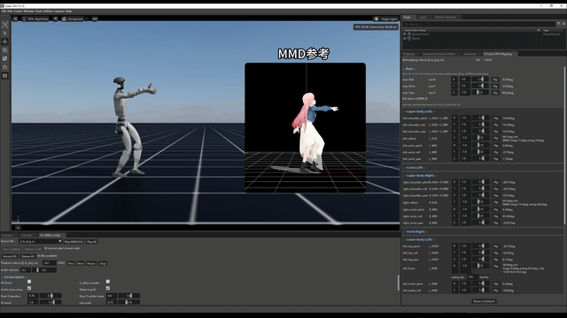
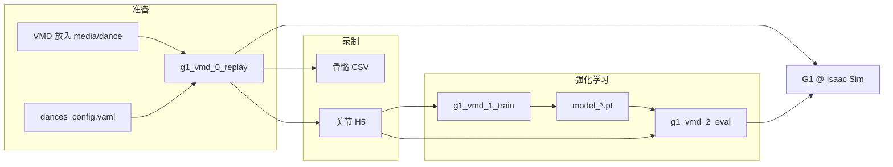

# Isaac-Robot-MMD

二次元角色实时预览和录像现默认采用独立的 `--look mmd-toon`（第 8 版）赛璐璐微调外观（环境光 75%、角色亮度 88%、刘海阴影 65%、暖色脸部塑形与细描边），地面保持原版。参数、入口及历史模式复现见 [角色外观说明](source/pmx_prototype/README.md)。


在 **NVIDIA Isaac Sim / Isaac Lab** 中，将 **MMD/VMD 骨骼动作** 重定向到 **宇树 G1（29 DOF + O6 手）**，并完成回放调试、参考数据集录制与 RL 跟踪训练。

## 演示


<p align="center">
  
</p>

（借物表：动作 by Yurie， 参考模型 by Bushiroad Games/BungleScrungle/海新_/小麦弥望）

---

## 项目简介

机器人全身动作的主流来源是WBC遥操、开源动作库或者视频数据逆解析，但 **MMD 社区** 已沉淀近二十年的 VMD 舞蹈资源，数量大、种类多、骨骼关节信息准确。因此，本项目提供一条解析VMD格式源文件（MMD动作数据），导入到IsaacSim进行回放，训练的整条流水线：

1. **VMD → 仿真骨骼 CSV**：自动或手动转换 MMD 动作；
2. **重定向与回放**：在 Isaac Sim 中映射到 G1 关节，支持 UI 微调、足部 IK、伴音同步；
3. **Record H5**：将调试好的轨迹编译为 RL 参考动作数据集；
4. **PPO 训练与验证**：以H5数据集为参考轨迹，用 PPO（RSL-RL） 训练腿部策略checkpoint；
5. **策略2Sim验证**：通过 eval 脚本在仿真中加载 checkpoint，对比 H5 关节跟踪误差。

整条链路围绕三个入口脚本组织（见下节），其余模块（环境注册、重定向算法、UI 等）为它们提供支撑。

### H5 默认重定向

新生成或导出的 H5 默认使用通用上肢求解与接触约束下肢求解：全身目标在内存中合成后直接写最终 H5，不生成旧映射中间 H5。录制、UI 导出、流水线及启动时补齐缺失 H5 使用同一默认选择；已有历史 H5 不自动覆盖。

- 默认 `--retarget_mode new`；对比旧映射时显式使用 `--retarget_mode legacy`。
- 源腿部默认 `--source_leg_mode fk`（已用 IRIS Out 验证的直接关节驱动）。脚步 IK 驱动的 VMD 必须显式选择 `--source_leg_mode ik`，不会按文件名猜测。
- 源 VMD 从 CSV 同名文件或 `.motion.json` 查找；重命名后没有关联信息时可用 `--source_vmd` 指定。流水线会自动传入原始 VMD。
- 缺省用本项目千早爱音 PMX/已转换骨架作为源骨架标定，自动烘焙并缓存源动画；缓存按 VMD、骨架、模型和烘焙代码内容区分。也可显式传入上下肢源动画文件。
- 当前下肢保留原骨盆/root 轨迹；部分姿态仍存在屈膝偏多的问题。限位与地面约束检查属于运动学验证，不等同于策略跟踪或动力学验证。
- 自碰撞修正默认采用 `--collision_mode local`：先验证保守避让轨迹，再用短时间窗向原动作恢复；每一步均复核碰撞、USD 关节限位/速度和拼接连续性。默认 `--collision_max_seconds 60` 限制的是姿态恢复时间，不是碰撞要求；预算耗尽仍保留上一个已验证的无碰撞结果，允许姿态更保守。手指及 root 数据保留，必要时扩大被调整的肢体范围。
- 默认检查原帧及帧间 1/4、1/2、3/4 插值点，要求代理间隙至少 0.5 mm；编码后的 H5 再复核。关节加速度不得超过源动作同帧值与 60 rad/s² 的较大者。该局部模式不声明已完成全曲笛卡尔手势拟合，也不等于动力学认证。
- 需要全曲手势保真时显式使用 `--collision_mode gesture`：拟合手相对头/胸的位置、手掌朝向和双手关系，并联合约束实际手部速度/加速度。该模式保留原来的全曲优化及稀疏二阶锥精修，需要 `clarabel>=0.11`，计算量显著更大。独立修正脚本的 `--legacy_collision` 继续保留旧几何方法作对照。
- 手部碰撞几何包含由实际关节驱动的逐节指骨胶囊，覆盖弯曲拇指等超出中立整手包络的部位；检查手指与头、躯干、对侧手臂和腿部。`--legacy_collision` 保留中立整手包络作对比。包络检查的范围由碰撞对列表定义，不能将其表述为所有可见网格之间完全无相交。
- 手部障碍物包括单独的髋 pitch/roll、踝 pitch 外壳。对已验证轨迹补齐碰撞几何时，可用独立修复脚本的 `--repair-only` 仅修自动检出的窗口，保留窗口外动作。启用避碰的 VMD 流水线在录像前还会运行整段真实三角网格检查（全部手部与非直接关节相邻部位，含四分之一帧插值）；有相交或报告与 H5 哈希不匹配时停止录像。
- 新链路同时约束 O6 手指。51 个关节均检查角度；41 个独立关节使用 USD 速度上限，10 个从动关节依据 USD mimic 比例推导速度限制并检查联动一致性。最终 H5 在录像前再次校验；不通过则停止流水线。


| 阶段   | 做什么                                           | 典型产出                         |
| ---- | --------------------------------------------- | ---------------------------- |
| 准备   | VMD 放入 `media/dance/<舞蹈名>/`，登记 `dances_config.yaml` | CSV / 可选 WAV                 |
| 回放调试 | 关节映射、根 Z 修正、Record H5                         | `*.h5` 参考轨迹                  |
| 训练   | 多环境并行 PPO，腿部残差跟踪 H5                           | `logs/rsl_rl/.../model_*.pt` |
| 验证   | 加载 checkpoint，对比参考关节误差                        | 可视化 + 跟踪指标                   |


> 更细的模块说明见 [source/OVERVIEW.md](source/OVERVIEW.md)。

---

## 核心脚本（三步工作流）

日常开发只需关注以下三个文件，按顺序使用：


| 步骤    | 脚本                                                               | 作用                                                                                                                    |
| ----- | ---------------------------------------------------------------- | --------------------------------------------------------------------------------------------------------------------- |
| **0** | `[g1_vmd_0_replay.py](source/train_workflow/g1_vmd_0_replay.py)` | **回放与重定向**：加载 VMD/CSV/H5，交互选舞、Mapping UI、足部 IK、伴音；启动时自动扫描 VMD 并生成 CSV/H5；UI 内 **Record H5** 导出训练用参考轨迹                 |
| **1** | `[g1_vmd_1_train.py](source/train_workflow/g1_vmd_1_train.py)`   | **PPO 训练**：读取 `media/dance/<dance>/<dance>.h5`，在 `Isaac-G1-Vmd-Train-C1-v0`（默认）上学习腿部残差策略；支持 `--dance`、`--window_frames`、课程学习等 |
| **2** | `[g1_vmd_2_eval.py](source/train_workflow/g1_vmd_2_eval.py)`     | **策略验证**：加载 `logs/rsl_rl/` 下最新或指定 checkpoint，在仿真中播放策略并统计相对 H5 的关节跟踪误差                                                 |


```text
VMD / CSV  ──►  g1_vmd_0_replay  ──►  H5  ──►  g1_vmd_1_train  ──►  checkpoint
                      ▲                                              │
                      └────────────  g1_vmd_2_eval  ◄────────────────┘
```

---

## 数据流




---

## 目录结构


| 路径                                                                | 作用                                                 |
| ----------------------------------------------------------------- | -------------------------------------------------- |
| `[source/train_workflow/](source/train_workflow/)`                | 三个 `g1_vmd_*` 入口、重定向工具、UI、辅助脚本                     |
| `[source/my_task/](source/my_task/)`                              | Gym 环境注册、MDP、机器人与训练配置                              |
| `[media/](media/)`                                                | **仅本地**（gitignore）：`dance/`、`pose/`、VMD/CSV/H5/WAV |
| `[docs/](docs/)`                                                  | 项目文档（本地，gitignore）                                 |
| `[assets/](assets/)`                                              | G1 29-DOF O6 手 USD 资产；`demo/` 存放 README 演示 GIF     |
| `[setup_env.bat](setup_env.bat)` / `[setup_isaac61.ps1](setup_isaac61.ps1)` | Windows 6.1 安装 |

舞蹈资源按 `media/dance/<舞蹈名>/` 归档，同一舞蹈的 VMD、CSV、H5、音频、参考视频、短版和修正报告放在一起，文件名保持不变。例如 `media/dance/IRIS_OUT/IRIS_OUT.vmd`。

`--dance IRIS_OUT` 等舞蹈名指令保持可用；项目脚本也兼容旧路径（如 `--motion_h5 media/dance/IRIS_OUT.h5`），会解析到对应子目录。新指令建议使用完整的新路径。回放会递归扫描 VMD，流水线默认将 CSV/H5 输出到舞蹈目录；指定其他 `--output_dir` 仍按指定目录保存。


---

## 环境要求（Windows 11 / Isaac Sim 6.1）

- **NVIDIA Isaac Sim 6.1.0** — 独立安装包位于 `I:\isaac61\IsaacSim`
- **Isaac Lab v3.0.0-EA** — 位于 `I:\isaac61\IsaacLab`，固定官方抢先体验标签
- **Python 3.12** — 使用 Isaac Sim 自带 Python；不要激活原来的 Conda 环境
- **安装入口**：`setup_env.bat` / `setup_isaac61.ps1`；下载和依赖缓存均配置在 I 盘
- **PyYAML**（读取 `dances_config.yaml`）

Windows 快速验证和启动：

```powershell
.\run_isaac61.bat
.\run_isaac61.bat source\train_workflow\smoke_isaac61.py --viz kit --steps 0
.\run_isaac61.bat source\train_workflow\smoke_isaac61.py --viz none --steps 60
.\run_isaac61.bat source\train_workflow\g1_vmd_0_replay.py
.\run_isaac61.bat source\train_workflow\g1_vmd_1_train.py --dance IRIS_OUT --window_frames 30 --num_envs 4 --max_iterations 1 --headless --episode_seconds 1 --experiment_suffix isaac61_smoke
.\run_isaac61.bat source\train_workflow\g1_vmd_2_eval.py --dance IRIS_OUT --num_envs 1
```

不带参数的启动运行 300 步后自动退出；`--steps 0` 保持窗口开启。2026-10-01 已在本机 RTX 5090 D v2 / 驱动 617.14 上验证 GUI、无窗口仿真、一次 PPO 更新、新 checkpoint 加载和原回放 UI 启动。安装版本、测试命令、日志路径和兼容性范围见 [ISAAC61_MIGRATION.md](ISAAC61_MIGRATION.md)。

CSV/H5 中的四元数继续使用 WXYZ；仿真 API 使用 XYZW，转换由项目边界代码完成。旧 RSL-RL checkpoint 需要另行迁移和验证，建议先用新版生成一个短训练 checkpoint。

也已另建 **Conda 环境 `isaac61`**，可以直接使用环境中的 Python：

```powershell
conda activate isaac61
cd I:\robot_isaac
python source\train_workflow\g1_vmd_0_replay.py
```

该环境采用独立的 Sim pip 安装，保留上述独立版。环境路径、编辑器选择、兼容依赖约束和实际验证记录见 [CONDA_ISAAC61.md](CONDA_ISAAC61.md)。

---

## 快速开始（Isaac Sim 6.1）

在仓库根目录准备本地配置和媒体：

```powershell
Copy-Item source/train_workflow/dances_config.example.yaml source/train_workflow/dances_config.yaml
# 将 VMD/CSV/H5/WAV 放入 media/（见 media/README.md）
```

使用 `isaac61` Conda 环境依次运行回放、训练和验证：

```powershell
conda activate isaac61
python source/train_workflow/g1_vmd_0_replay.py
python source/train_workflow/g1_vmd_1_train.py --task Isaac-G1-Vmd-Train-C1-v0 --num_envs 2048 --viz none --dance ji_le_jing_tu
python source/train_workflow/g1_vmd_2_eval.py --task Isaac-G1-Vmd-Train-C1-v0 --num_envs 1 --dance ji_le_jing_tu --window_frames 2690
```

独立版环境使用上节的 `run_isaac61.bat` 启动相同脚本。

### 自动验收录像的 PMX 视频对照

`Isaac-G1-Vmd-Auto-Jump-Conditional-v0` 的中期和最终验收录像支持与先前录制的 PMX MP4 同步对照。默认列表是 `source/train_workflow/validation_videos.json`，其中 `video` 是本地 MP4 路径（相对路径从仓库根目录解析），`start_seconds` 是视频中对应动作第 0 帧的秒数。空 `video` 表示只输出原验收录像。

Iris Out 已登记 `media/dance/IRIS_OUT/IRIS_OUT_pmx.mp4`。修正版 H5 会通过 `.motion.json` 的 `source_dance` / VMD / 音频来源匹配原舞蹈；精确 H5 名称的配置优先。其他舞蹈可在列表中填写各自的已验证视频。

在现有自动训练命令中可追加以下参数覆盖默认配置，无需重录 PMX：

```powershell
--validation_reference_video "I:\videos\IRIS_OUT_pmx.mp4" `
--validation_reference_start_seconds 0
```

`--validation_reference_config "路径.json"` 指定其他列表，`--no_validation_reference_video` 仅关闭本次 PMX 对照。新运行保存所选视频路径和时间偏移；已有旧运行的录像子进程可从当前默认列表解析。

输出保留原 `validation_seeds.mp4`，另生成同目录的 `validation_seeds_comparison.mp4`（单种子为 `validation_comparison.mp4`）及合成说明 JSON。左侧 PMX、右侧原有三个种子画面，保持比例，以验收录像的动作时钟及音轨为准；支持片头偏移、局部预览、慢放和末尾保持。PMX 比验收片段短时定格末帧。合成失败保留原验收录像和判定。

已完成的验收录像也可以单独合成，不启动 Isaac Sim 或策略：

```powershell
python source\train_workflow\scripts\compare_validation_video.py `
  --validation "完整路径\validation_seeds.mp4" `
  --dance IRIS_OUT_gesture_final_v2
```

该命令使用验收 MP4 同名的 JSON 读取动作时钟。换参考视频时可追加相同的 `--validation_reference_video` 与 `--validation_reference_start_seconds` 参数。

### 所有舞蹈的脚尖触地验收容差

`quality_profiles/<reference_key>.json` 可为精确绑定的 H5、窗口、控制频率和末帧保持配置指定验收标准。`swing_limits.early_contact_s` 与 `swing_limits.early_contact_fraction` 分别控制抬脚阶段的连续触地时长、局部触地比例；所有舞蹈默认统一采用 0.4 秒与 90%。新生成的 profile 显式保存这两个值，舞蹈专用 profile 仍可显式覆盖。

用户已认可 Iris Out 第 2500 次的观感，并明确要求将这份触地容差推广到所有舞蹈。身体误差、抬脚高度误差、完整性和腾空检查保持原有标准。

新训练自动查找匹配 profile；运行中的任务不热更新标准。旧 checkpoint 若未保存 `swing_limits`，续训时自动采用统一新容差，保存旧验收记录并重新累计质量历史及 best。已有显式 `swing_limits` 的 checkpoint 保持其冻结配置；可通过 `--auto_quality_profile "新profile完整路径"` 显式切换。切换不把旧失败记录改写为当时已通过。

### IDE 配置（可选）

```bash
cp pyrightconfig.example.json pyrightconfig.json
# 示例已指向 isaac_workspace_61 和 Sim 自带的 Python 3.12，无需 Conda
```

---

## 未来计划的工作:

- [ ] **手部重定向优化**：更准确的重定向一致性
- [ ] **C1 训练稳定性**：提升 `g1_vmd_1_train` 长序列VMD动作数据的跟踪质量和训练效率
- [ ] **C2 实验任务**：完善课程C2的训练链路
- [ ] **VMD镜头数据**：镜头数据兼容
- [ ] **VMD更多参数调整**：toe IK，表情，motion scale，部分关节锁定的动作执行等
- [ ] **Sim2Sim**：更好的policy eval效率，完善sim2im部署UI界面
- [ ] **Sim2Real**：策略导出与真机部署验证（暂无实机喵）
- [ ] **PMX暴力导入isaacsim**：PMX转URDF？……真的可以吗？至少尝试下吧
- [ ] **RTX ON**：测试更高的画质，更好的物理解算，堂堂取代Blender（误

---

## 仓库不包含的内容

本仓库仅提供**源代码**。详见 [THIRD_PARTY_NOTICES.md](THIRD_PARTY_NOTICES.md)。


| 项目        | 说明                                                                           |
| --------- | ---------------------------------------------------------------------------- |
| Isaac Sim | 需自行下载，受 NVIDIA 许可约束                                                          |
| Isaac Lab | 从 GitHub 克隆安装                                                                |
| MMD 动作与音频 | 本地放入 `media/`（见 [media/README.md](media/README.md)）                          |
| 舞蹈登记配置    | 复制 `source/train_workflow/dances_config.example.yaml` → `dances_config.yaml` |


---

## 许可证

本仓库**原创代码**采用 **[Apache License 2.0](LICENSE)**。

部分源自 [Isaac Lab](https://github.com/isaac-sim/IsaacLab) 的文件保留 **BSD-3-Clause** 版权声明与 SPDX 头注释。第三方组件与「需用户自行获取」的内容说明见 [THIRD_PARTY_NOTICES.md](THIRD_PARTY_NOTICES.md)。

---

## 免责声明

- 本项目为**独立开源项目**，与 **NVIDIA**、**宇树（Unitree）** 或 **MMD/PMD 动作及模型版权方** **无关联、无授权、无背书关系**。
- 本仓库**不包含** Isaac Sim 安装包、Isaac Lab 源码或 MMD 动作/音频数据；使用者须自行获取并遵守各第三方的许可与 copyright 规定。
- 代码与文档按「现状」（AS IS）提供，**不提供任何明示或默示担保**；因使用本项目而产生的任何风险或损失由使用者自行承担。

