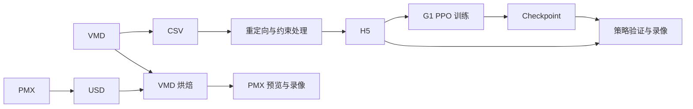

# 架构与代码导航

本文描述当前工作区的模块边界。使用说明见 [根 README](../README.md)，测试分层与依赖见 [TESTING.md](../TESTING.md)。

## 两条主要链路

- **G1 动作跟踪**：VMD → CSV → 重定向/约束处理 → H5 参考轨迹 → PPO 训练 → checkpoint → 策略验证与录像。
- **PMX 角色**：PMX → USD 角色资产，VMD → 骨骼动画；运行时结合外观、头发/裙摆物理进行预览与录像。另有角色运动策略的训练、评估与发布链路。

## 从功能找入口

以下路径相对本目录；脚本完整参数以入口代码为准。

| 功能 | 入口 | 配套说明 |
| --- | --- | --- |
| G1 回放、映射 UI、H5 导出 | [g1_vmd_0_replay.py](train_workflow/g1_vmd_0_replay.py) | [共享库导航](train_workflow/utils/README.md) |
| G1 训练 | [g1_vmd_1_train.py](train_workflow/g1_vmd_1_train.py) | [Auto-Jump 工作流](train_workflow/AUTO_JUMP_TRAINING.md) |
| G1 策略验证与播放 | [g1_vmd_2_eval.py](train_workflow/g1_vmd_2_eval.py) | [部署包](train_workflow/DEPLOYMENT.md) |
| VMD → H5 → 视频流水线 | [g1_vmd_pipeline.py](train_workflow/g1_vmd_pipeline.py) | [根 README](../README.md) |
| PMX 转换、动作烘焙、资产查看 | [convert_pmx.py](pmx_prototype/convert_pmx.py)、[load_vmd.py](pmx_prototype/load_vmd.py)、[view_character.py](pmx_prototype/view_character.py) | [PMX 总览](pmx_prototype/README.md) |
| 角色舞蹈预览 | [preview_dance.py](pmx_prototype/tools/preview_dance.py)、[physx_dance.py](pmx_prototype/physx_dance.py) | [已验收回放](pmx_prototype/PLAYBACK.md) |
| PMX 录像 | [record_physx_video.py](pmx_prototype/record_physx_video.py)、[record_cached_secondary.py](pmx_prototype/record_cached_secondary.py) | [PMX 总览](pmx_prototype/README.md) |
| 角色策略训练与播放 | [train_anon_locomotion.py](pmx_prototype/train_anon_locomotion.py)、[play_anon_policy.py](pmx_prototype/play_anon_policy.py)、[inspect_anon_policy.py](pmx_prototype/inspect_anon_policy.py) | [角色运动训练](pmx_prototype/ANON_LOCOMOTION.md) |
| 分类工具发现 | [pmx.py](pmx_prototype/pmx.py) 的 `list` 子命令 | [分类配置](pmx_prototype/configs/README.md) |
| 测试与冒烟验证 | [run_tests.py](../run_tests.py) | [测试指南](../TESTING.md) |

## 模块职责与现有依赖

| 目录/模块 | 职责 |
| --- | --- |
| `my_task/` | Gym 环境注册、G1 环境配置；`mdp/` 定义动作、观测、奖励和重置；`motion_reference/` 缓存训练参考轨迹 |
| `my_task/robots/` | G1 USD 配置、执行器 PD；`agents/` 提供 RSL-RL 配置 |
| `train_workflow/utils/format/` | CSV/H5 读写；目前 CSV 插值、重定向和 H5 编译也在此处 |
| `train_workflow/utils/retarget/`、`ik/` | 关节映射、上下肢重定向、足部 FK/IK |
| `train_workflow/utils/motion/` | 动作解析、来源追踪、同步、关节约束和碰撞修正 |
| `train_workflow/utils/playback/`、`media/` | 回放控制辅助、状态写入、录制、伴音与视频合成 |
| `train_workflow/utils/` 顶层 | 训练控制、质量验收、进度、checkpoint、部署和验证录像 |
| `train_workflow/ui/` | Isaac UI 面板与回调；`scripts/` 包含离线工具及历史位置的 G1 单元测试 |
| `pmx_prototype/runtime/` | 外观、角色语义、头发/裙摆物理、音频、实时物理 worker 与场景辅助 |
| `pmx_prototype/training/` | 角色环境、策略通信、检查器、AMP 和训练辅助 |
| `pmx_prototype/motion/` | 动作参考、重定向、参考库构建与处理 |
| `pmx_prototype/diagnostics/`、`tools/` | 诊断评估、批处理、预览包装、发布与下载工具 |
| `pmx_prototype/configs/`、`archive/` | 分类运行配置；历史实验、冻结配置和校验目录 |
| `paths.py`、`sim_compat.py` | 公共资产定位；Sim 6.1 / Lab 3 API 与四元数边界适配 |

当前尚非严格单向分层：`my_task` 使用 `train_workflow.utils` 中的 H5/质量计算；PMX 录像复用该目录的视频捕获；G1 重定向调用 PMX 烘焙，评估也可接入 PMX 同屏场景。修改公共实现时应同时考虑两条链路。

PMX 分类迁移通过 `source_layout.py`、`module_locations.json` 和包搜索路径兼容旧名称；`source_bundle.py` 为训练快照和发布包收集源码。移动文件时应同步映射、资源定位、打包依赖和目录兼容性测试。此次导航更新不改变导入规则。

## 必须明确的运行边界

- **初始化顺序**：Isaac 入口先创建 `AppLauncher` / `SimulationApp`，再导入需要 Kit 的 `omni`、`pxr` 或仿真模块。不要通过导入入口脚本来获取其函数或参数。
- **四元数**：CSV 的 `quat_x/y/z/w` 列为 XYZW；读取后的骨字典 `quat_wxyz` 与 H5 的 `root_quat_delta_wxyz` 为 WXYZ；当前 Lab 3 仿真状态接口使用 XYZW，由 `sim_compat.py` 和边界写入代码转换。不能对所有文件格式或 USD 类型一概套用同一顺序。
- **外观默认**：[runtime/appearance_defaults.py](pmx_prototype/runtime/appearance_defaults.py) 保存已认可的 `mmd-toon` 参数；实现见 `character_appearance.py`、`bangs_shadow.py` 与 `mmd_cel.mdl`。新入口应复用共享设置，地面保持场景原版。
- **物理与配置**：共享物理默认在 `configs/physics/secondary_default.json`；旧配置路径由 `config_path()` 兼容，自定义已有文件优先。历史版本保留原因见配置目录与 archive 说明。
- **诊断与测试**：`check_*` / `validate_*` 不自动等同于单元测试，部分会启动仿真、读取本地资产或生成录像；统一入口只运行显式登记的项目。

## 数据、输出与文档位置

| 路径（相对仓库根） | 用途与版本管理 |
| --- | --- |
| `assets/` | 仓库内 G1 USD 资产及演示图 |
| `media/dance/<舞蹈>/`、其他 `media/` 子目录 | 本地动作、音频、角色资源及录像；媒体数据不提交 |
| `logs/`、`policy/`、`output/` | 训练结果、策略包、转换缓存和诊断产物；不提交 |
| `output/tests/<运行编号>/` | 统一测试入口的逐文件日志与 JSON 汇总 |
| `source/train_workflow/dances_config.yaml` | 本地舞蹈登记；从受版本控制的 example 文件复制 |
| 根 README、`source/` 内 Markdown | 当前使用与模块说明，随代码版本管理 |
| `docs/` | 本地资料目录，已被 gitignore；共享架构文档不放这里 |

环境安装见 [CONDA_ISAAC61.md](../CONDA_ISAAC61.md) 与 [ISAAC61_MIGRATION.md](../ISAAC61_MIGRATION.md)。历史实验的参数与结论仅对应其记录时的阶段；当前行为以入口实现、共享配置和已验收说明为准。
